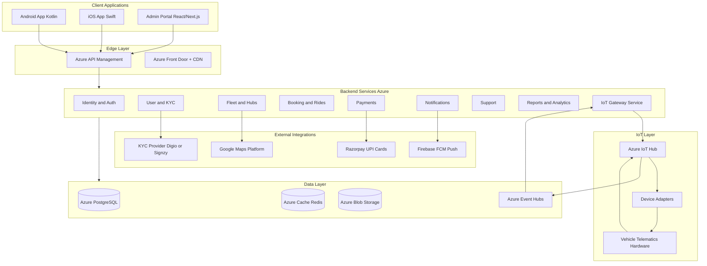
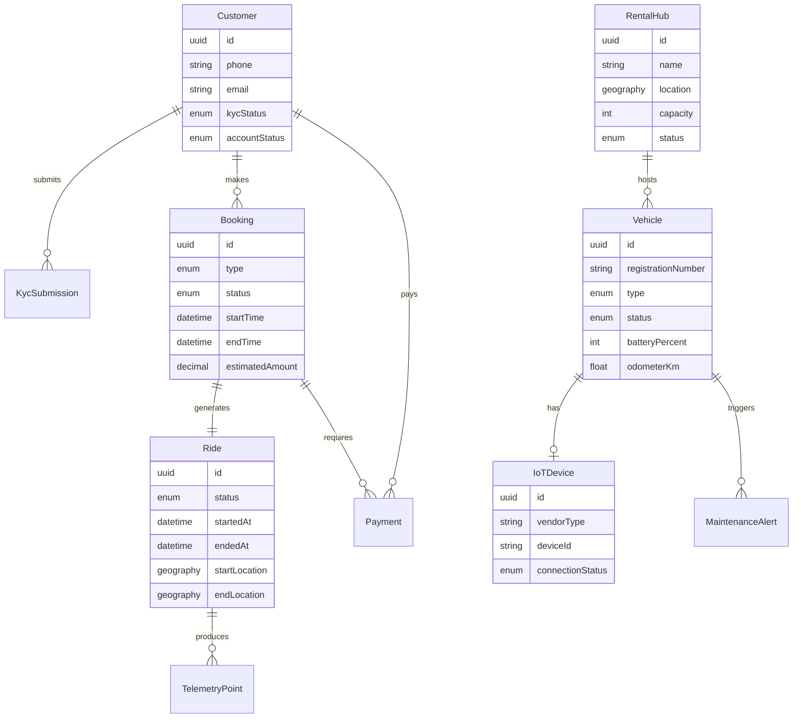
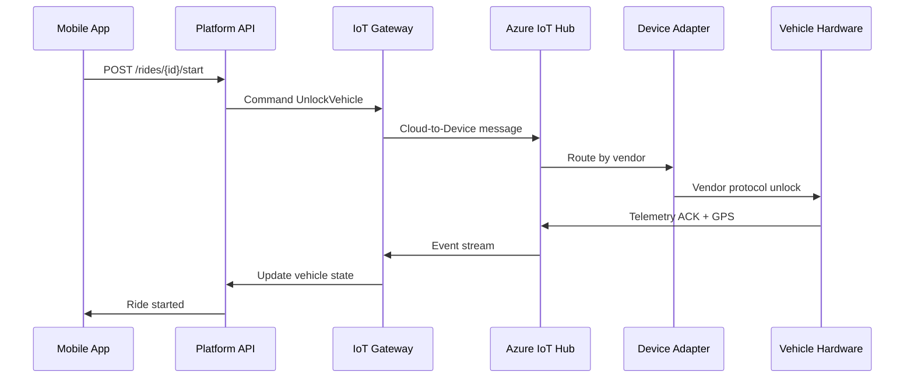

# Digi-Switchride Platform — Architecture & Delivery Plan

## Context

- **Workspace:** Empty Git repo at [`C:\Users\Megala\Projects\Digi-Switchride`](C:\Users\Megala\Projects\Digi-Switchride) — true greenfield.
- **Product model:** App-based e-scooter/e-bike rental (locate hub → KYC → book → unlock → ride → pay → return), similar to [switcheride.com](https://switcheride.com/).
- **Decisions locked in:**
  - **Mobile:** Fully native — Kotlin (Android) + Swift (iOS)
  - **Market:** India first — Aadhaar/PAN/DL KYC, UPI/Razorpay, INR

---

## High-Level Architecture



---

## Recommended Tech Stack

| Layer | Choice | Rationale |
|-------|--------|-----------|
| **Backend** | **.NET 8** (ASP.NET Core) | First-class Azure support, strong for enterprise APIs, good long-term maintainability |
| **Architecture style** | **Modular monolith → microservices** | Faster MVP; split Booking/Ride, Payment, IoT when load demands it |
| **Admin portal** | **Next.js 15 + TypeScript + Tailwind + shadcn/ui** | Rich CRUD/dashboard UX, SSR, fast to build |
| **Android** | **Kotlin + Jetpack Compose + MVVM + Hilt** | Modern native Android standard |
| **iOS** | **Swift + SwiftUI + MVVM** | Modern native iOS standard |
| **API contract** | **OpenAPI 3.1** | Shared spec drives mobile SDK generation and APIM policies |
| **Primary DB** | **Azure Database for PostgreSQL (Flexible Server)** | Relational model fits bookings, fleet, finance |
| **Cache** | **Azure Cache for Redis** | Sessions, hub/vehicle availability, rate limits |
| **Object storage** | **Azure Blob Storage** | KYC document images, report exports |
| **Messaging** | **Azure Service Bus** (commands) + **Event Hubs** (IoT telemetry) | Decouple ride events, payments, notifications |
| **Identity** | **Azure Entra External ID** (B2C successor) | OTP/mobile login, social optional later |
| **IoT** | **Azure IoT Hub** + custom **adapter SDK** | Vendor-agnostic device abstraction |
| **IaC** | **Bicep** or **Terraform** | Repeatable Azure environments (dev/staging/prod) |
| **CI/CD** | **GitHub Actions** | Build Android/iOS/backend/admin; deploy to Azure |

---

## Repository Structure (Monorepo)

```
Digi-Switchride/
├── apps/
│   ├── customer-android/       # Kotlin, Gradle
│   ├── customer-ios/           # Swift, Xcode project
│   └── admin-web/              # Next.js admin portal
├── services/
│   └── platform-api/           # .NET modular monolith (initial)
│       ├── src/
│       │   ├── Api/              # HTTP controllers, middleware
│       │   ├── Modules/
│       │   │   ├── Identity/
│       │   │   ├── UsersKyc/
│       │   │   ├── Fleet/
│       │   │   ├── Bookings/
│       │   │   ├── Rides/
│       │   │   ├── Payments/
│       │   │   ├── Notifications/
│       │   │   ├── Support/
│       │   │   ├── Reports/
│       │   │   └── IoT/
│       │   └── Shared/           # Domain events, common types
│       └── tests/
├── iot/
│   ├── gateway/                  # .NET IoT Gateway (IoT Hub bridge)
│   ├── adapters/                 # Per-vendor adapters (MQTT, TCP, HTTP)
│   └── simulator/                # Dev vehicle simulator
├── contracts/
│   └── openapi/                  # Single source of API truth
├── infra/
│   ├── bicep/                    # Azure resources
│   └── environments/             # dev, staging, prod params
├── docs/
│   ├── architecture/
│   ├── adr/                      # Architecture Decision Records
│   └── runbooks/
└── .github/workflows/
```

---

## Core Domain Model



**Key status flows:**
- **KYC:** `Pending → UnderReview → Approved | Rejected → (resubmit)`
- **Booking:** `Draft → Confirmed → Active → Completed | Cancelled | NoShow`
- **Ride:** `NotStarted → InProgress → Ended | ForceEnded`
- **Vehicle:** `Available → Reserved → InRide → Maintenance → Offline`

---

## Backend Modules — Responsibilities

### 1. Identity & Authentication
- Mobile OTP login (SMS via Azure Communication Services or MSG91)
- JWT access tokens + refresh tokens
- Role-based access: `Customer`, `HubOperator`, `FleetManager`, `Finance`, `SupportAgent`, `SuperAdmin`
- Device binding and session revocation

### 2. Users & KYC (India)
- Profile: name, phone, email, emergency contact
- Document capture: Aadhaar (masked storage), PAN, Driving Licence, selfie/liveness
- Integrate **KYC aggregator** (recommend **Digio** or **Signzy** for Aadhaar XML/DigiLocker, PAN, DL verification)
- Admin review queue for edge cases
- Store documents in **Blob Storage** (encrypted, private containers); metadata in PostgreSQL
- **Compliance notes:** UIDAI/Aadhaar usage rules, DPDP Act 2023 data minimization, consent logging, retention policy

### 3. Fleet & Rental Hubs
- CRUD hubs with geo-fences (PostGIS extension on PostgreSQL)
- Vehicle registry: model, VIN, registration, hub assignment, pricing tier
- Real-time availability derived from vehicle status + active bookings
- **Nearby hubs API:** geospatial query within radius (used by mobile map)

### 4. Bookings & Rides
- Booking types: **per-minute**, **hourly**, **daily**, **weekly**, **monthly** (match SwitchRide pricing models)
- Pricing engine: base rate + time + distance + surge/promo
- Start ride: validate KYC approved, payment method, vehicle available, send unlock command via IoT
- End ride: lock vehicle, compute final fare, capture payment
- Idempotent APIs for start/end (critical for mobile retries)

### 5. Payments (India)
- **Razorpay** integration: UPI, cards, wallets
- Payment flows: pre-auth/deposit at booking, capture at ride end, refunds
- Wallet/ledger table for delivery rider plans (weekly/monthly prepaid)
- Webhook handler with signature verification and reconciliation jobs
- GST invoice generation (configurable rates per plan)

### 6. Notifications
- Push: **Firebase Cloud Messaging** (Android + iOS)
- SMS: booking confirmations, OTP, ride alerts
- Email: receipts, KYC status (Azure Communication Services or SendGrid)
- Event-driven: `RideStarted`, `RideEnded`, `PaymentFailed`, `KycApproved`

### 7. Support
- In-app ticket creation with category, booking reference, attachments
- Admin assignment, SLA tracking, internal notes
- Optional: integrate Freshdesk/Zoho Desk later; build minimal ticketing in MVP

### 8. Reports & Analytics
- Operational dashboards: active rides, fleet utilization, hub occupancy
- Finance: revenue, refunds, outstanding, GST reports
- Export CSV/PDF via background jobs
- **Azure Application Insights** + custom metrics; optional **Power BI** embed for admin

### 9. IoT Gateway (see dedicated section)

### 10. System Configuration
- Feature flags, pricing tables, promo codes, hub operating hours, maintenance windows
- Audit log for all admin mutations (who/when/before/after)

---

## IoT Platform Design

**Goal:** Vendor-agnostic layer so new telematics hardware can be added without changing booking/ride logic.



**Command catalog (internal API):**
| Command | Description |
|---------|-------------|
| `Lock` | Lock vehicle |
| `Unlock` | Unlock vehicle |
| `IgnitionOn` / `IgnitionOff` | Start/stop motor (vendor-dependent) |
| `GetLocation` | Request GPS fix |
| `GetBattery` | State of charge |
| `GetOdometer` | Mileage reading |
| `GetHealth` | Diagnostic snapshot |

**Telemetry ingestion:**
- Device → IoT Hub (MQTT/AMQP) → Event Hub → IoT Gateway processor
- Normalize to canonical schema: `{ deviceId, timestamp, lat, lng, battery, odometer, alerts[] }`
- Store latest state in Redis; historical trail in PostgreSQL (partitioned by date)

**Adapter pattern:**
```
iot/adapters/
├── IDeviceAdapter.cs          # interface
├── MqttGenericAdapter/        # configurable topic mapping
├── VendorAAdapter/            # e.g. specific Indian telematics OEM
└── SimulatorAdapter/          # dev/test
```

**Alerts:** geofence exit, tamper, low battery, offline heartbeat — route to admin dashboard + optional auto end-ride rules.

**MVP IoT note:** Phase 1 can use **simulator + manual hub ops**; Phase 2 connects real hardware once vendor is selected.

---

## Customer Mobile Apps (Native)

Shared feature parity between Android and iOS; communicate only via REST/GraphQL APIs (recommend REST + OpenAPI for simplicity).

| Screen / Flow | Details |
|---------------|---------|
| Onboarding | Phone OTP → profile → KYC document upload |
| KYC | Camera capture, Digio/Signzy SDK WebView or native SDK |
| Map home | Nearby hubs (Google Maps), vehicle pins, availability count |
| Vehicle detail | Battery, pricing, book CTA |
| Booking | Plan selection, fare estimate, Razorpay checkout |
| Active ride | Timer, map tracking, end ride, support shortcut |
| Payments | Saved methods, transaction history, invoices |
| History | Past bookings/rides with receipts |
| Support | Create ticket, FAQ, call/chat link |

**Shared mobile concerns:**
- OpenAPI-generated API clients (separate gen per platform or hand-written thin layer)
- Secure token storage (Android Keystore / iOS Keychain)
- Offline-tolerant start/end ride with retry queue
- Deep links for payment return URLs

---

## Admin Portal Modules

| Module | Key capabilities |
|--------|------------------|
| **Customers** | Search, KYC review/approve/reject, suspend, view ride history |
| **Vehicles** | CRUD, assign hub, status override, IoT device pairing |
| **Fleet** | Bulk import, maintenance scheduling, utilization view |
| **Rental Hubs** | Geo-fence editor (map), capacity, operating hours |
| **Bookings** | Filter, cancel, refund trigger |
| **Active Rides** | Live map, force end, contact rider |
| **Finance** | Transactions, refunds, GST reports, Razorpay reconciliation |
| **Promotions** | Coupon codes, referral, surge rules |
| **Support** | Ticket queue, assignment, macros |
| **Reports** | Exportable operational/financial reports |
| **Analytics** | Dashboards: rides/day, revenue, fleet uptime |
| **IoT Devices** | Device registry, last seen, send test command, alert inbox |
| **System Config** | Pricing, roles, feature flags, audit log viewer |

**Auth:** Admin users via Entra External ID with MFA; separate from customer pool.

---

## Azure Infrastructure (per environment)

| Resource | Purpose |
|----------|---------|
| Resource Group | Environment boundary |
| Azure API Management | Rate limiting, JWT validation, versioning, developer portal |
| Azure App Service (or AKS later) | Host .NET API |
| Azure Database for PostgreSQL + PostGIS | Primary datastore |
| Azure Cache for Redis | Cache + pub/sub for live ride updates |
| Azure Blob Storage | KYC docs, exports |
| Azure Key Vault | Secrets, Razorpay keys, IoT connection strings |
| Azure IoT Hub | Device connectivity |
| Azure Event Hubs | Telemetry pipeline |
| Azure Service Bus | Domain events |
| Azure Functions | Webhook processors, scheduled reconciliation |
| Azure Front Door | WAF, TLS, admin CDN |
| Application Insights + Log Analytics | Observability |
| Azure Communication Services | SMS (or MSG91 via API) |

**Environments:** `dev` → `staging` → `prod` with separate Key Vault, DB, and IoT Hub namespaces.

---

## Security & Compliance (India)

- **DPDP Act 2023:** consent records, data localization preference (Azure India regions: Central India / South India)
- **Aadhaar:** use licensed KYC partner; never store full Aadhaar number unmasked
- **PCI:** no raw card storage — Razorpay handles tokenization
- **API:** OWASP top 10, APIM throttling, mTLS for IoT devices where supported
- **Audit:** immutable audit log for admin and payment actions

---

## Phased Delivery Roadmap

### Phase 0 — Foundation (2–3 weeks)
- Monorepo scaffold, OpenAPI skeleton, Bicep dev environment
- CI: backend build/test, admin build, Android/iOS lint
- Entra External ID + OTP login stub
- PostgreSQL schema v1, migration tooling (EF Core)

### Phase 1 — MVP Core (8–10 weeks)
**Goal:** End-to-end ride without real IoT (simulated unlock)

- Customer: register, KYC upload, map hubs, book, start/end ride (simulated), Razorpay pay, history
- Admin: customers, hubs, vehicles, bookings, basic KYC approval
- Backend: Identity, KYC metadata, Fleet, Booking/Ride, Payments, Notifications
- IoT: simulator only

### Phase 2 — IoT & Real-Time (6–8 weeks)
- Azure IoT Hub provisioning, first vendor adapter
- Live GPS on active ride map (admin + mobile)
- Lock/unlock/ignition commands wired to ride lifecycle
- Device health alerts in admin

### Phase 3 — Operations & Growth (6–8 weeks)
- Promotions, delivery rider plans (weekly/monthly)
- Support ticketing, reports, analytics dashboards
- Finance reconciliation, GST invoicing
- Battery swap station concept (hub type extension) if needed

### Phase 4 — Scale & Hardening (ongoing)
- Split hot modules to separate App Services/AKS services
- Multi-city hub rollout tooling
- Performance testing, DR drill, penetration test

---

## Critical API Endpoints (MVP subset)

```
POST   /auth/otp/send
POST   /auth/otp/verify
GET    /me
POST   /kyc/submissions
GET    /kyc/status

GET    /hubs/nearby?lat=&lng=&radiusKm=
GET    /hubs/{id}/vehicles

POST   /bookings
GET    /bookings/{id}
POST   /bookings/{id}/cancel

POST   /rides/{id}/start
POST   /rides/{id}/end
GET    /rides/active

POST   /payments/orders          # Razorpay order create
POST   /payments/webhooks/razorpay

GET    /rides/history
POST   /support/tickets
```

Admin routes under `/admin/*` with elevated roles.

---

## Key Risks & Mitigations

| Risk | Mitigation |
|------|------------|
| IoT vendor lock-in | Adapter interface + simulator from day 1 |
| KYC regulatory complexity | Licensed third-party KYC SDK; legal review before launch |
| Ride start/end failures | Idempotent APIs, command timeout + admin override |
| Payment webhook misses | Reconciliation job + manual admin tools |
| Dual native app cost | Shared OpenAPI spec, parallel feature flags, same QA test cases |

---

## Immediate Next Steps (after plan approval)

1. Initialize monorepo structure and root `README.md` with architecture link
2. Create `contracts/openapi/platform-v1.yaml` with MVP endpoints
3. Scaffold `.NET platform-api` with module folders and EF Core + PostGIS
4. Scaffold `admin-web` (Next.js) with auth shell and sidebar layout
5. Create Android and iOS project shells with map + auth navigation graphs
6. Deploy Azure `dev` environment via Bicep (APIM, App Service, PostgreSQL, Key Vault)
7. Write ADR-001: Modular monolith choice; ADR-002: Native mobile choice; ADR-003: KYC provider selection
